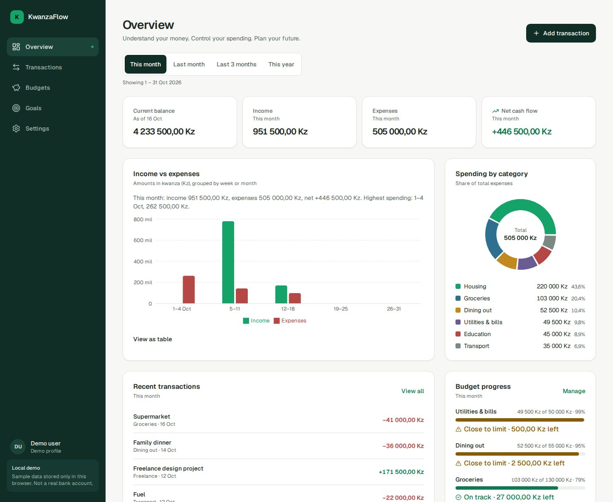
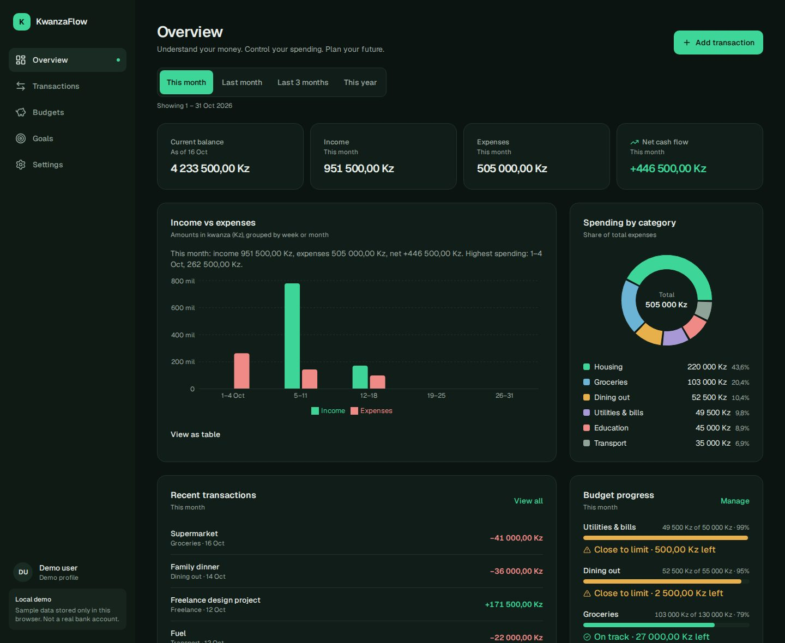
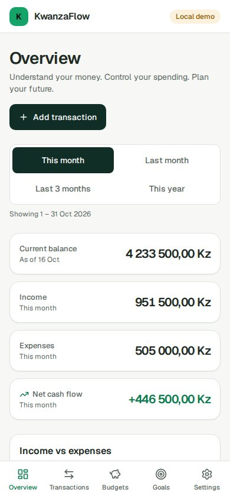
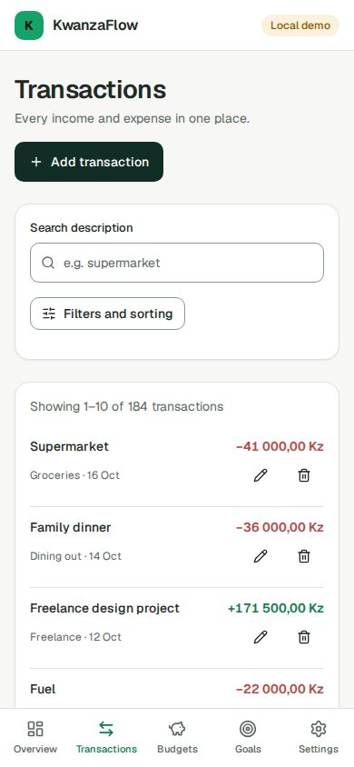
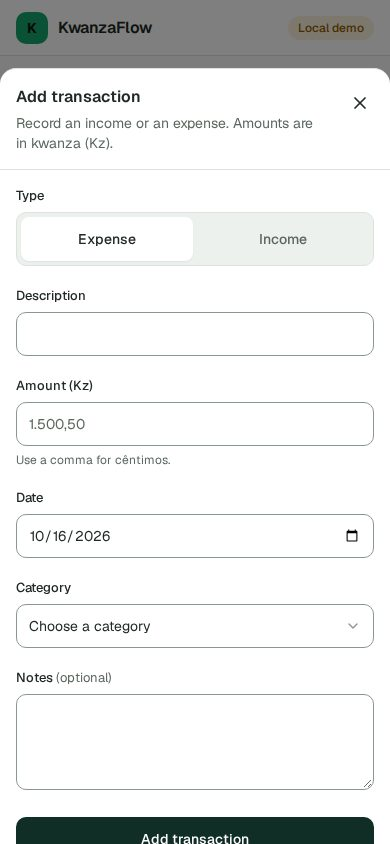
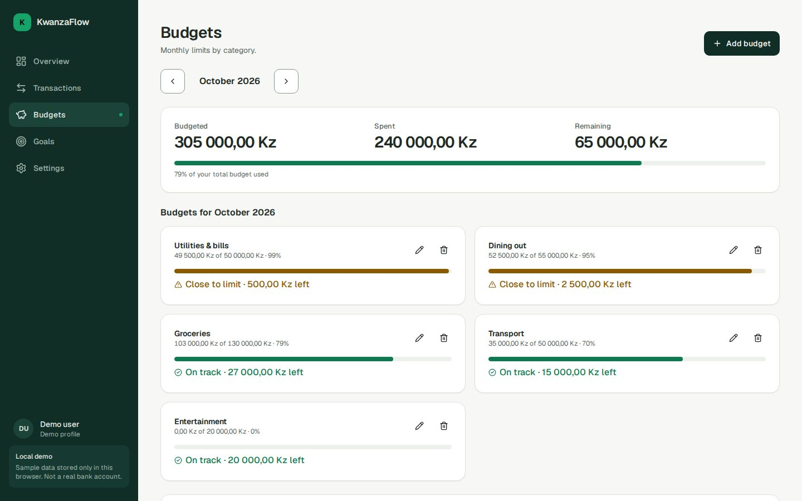
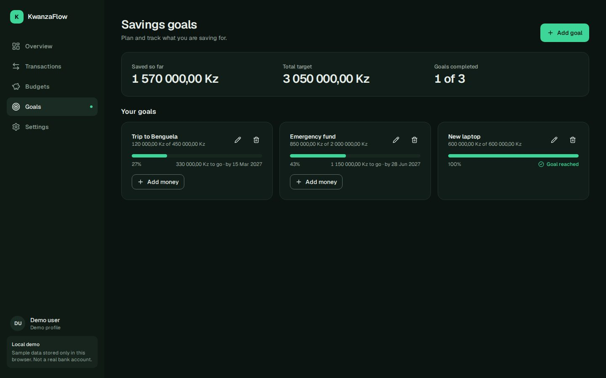
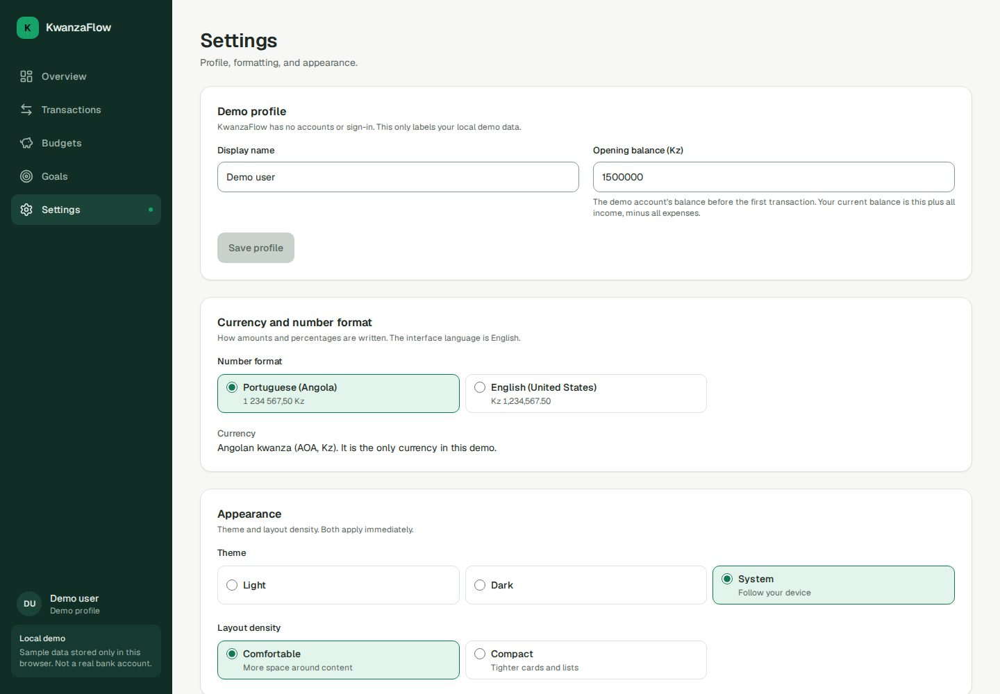

# KwanzaFlow

**Understand your money. Control your spending. Plan your future.**

A personal-finance app for the Angolan kwanza (AOA / Kz), built as a frontend-focused MVP: realistic demo data,
everything stored in the browser, no backend and no real banking. It is a portfolio project, so the emphasis is on
correctness, accessibility, and being honest about what has and has not been verified.

> **This is a local demo.** There are no accounts, no sign-in, and no connection to any bank. The "demo profile" is
> a label for local data, and the app says so on every screen. Data lives only in your browser's `localStorage`.

| Overview (desktop)                                                     | Overview (dark)                                                      |
| ---------------------------------------------------------------------- | -------------------------------------------------------------------- |
|  |  |

| Overview (phone)                                             | Transactions (phone)                                                 | Add transaction (phone)                                               |
| ------------------------------------------------------------ | -------------------------------------------------------------------- | --------------------------------------------------------------------- |
|  |  |  |

| Budgets                                          | Goals (dark)                                                           | Settings                                           |
| ------------------------------------------------ | ---------------------------------------------------------------------- | -------------------------------------------------- |
|  |  |  |

## The problem

People who earn and spend in kwanza, whether salaried, freelancing, or running a household, rarely see their money
as one coherent picture. KwanzaFlow answers three questions at a glance: _where did it go_ (income, expenses,
categories), _am I on track_ (monthly budgets), and _what am I saving toward_ (goals).

## Features

- **Overview:** balance, income, expenses and net cash flow for a chosen period; income-vs-expense and
  spending-by-category charts (each with a text summary and a data-table alternative); recent transactions; budget
  progress; savings goals. The period lives in the URL (`?period=last-month`).
- **Transactions:** create, edit and delete (with confirmation); search (case- and accent-insensitive); filter by
  type, category and date range; stable sorting; pagination.
- **Budgets:** monthly limits per category, a month switcher, progress, remaining or overspent amounts (in words and
  icons, never colour alone), "copy last month", and a list of spending that has no budget.
- **Savings goals:** create, edit, add money (never negative), completed and overdue states.
- **Settings:** demo profile, number format, light/dark/system theme, layout density, reset demo data.
- Works on phones (bottom tab bar, bottom-sheet dialogs, collapsible filters), tablets and desktops.

## Tech stack

Next.js 16 (App Router) · React 19 · TypeScript (strict) · Tailwind CSS 4 · Radix UI primitives (shadcn/ui style,
hand-written) · Lucide · Recharts · React Hook Form + Zod · date-fns · next-themes · sonner ·
Vitest + React Testing Library · Playwright + axe-core · ESLint + Prettier.
No state library (an external store + `useSyncExternalStore` was enough) and no data-fetching library (there is no
server data).

## Architecture

```text
UI components ─▶ feature hooks/components ─▶ pure domain services ─▶ repository ─▶ localStorage adapter
     │                                              │
     └──────────── pure calculations ◀──────────────┘   (no React, no storage, no formatting)
```

- `src/lib/calculations` is the single source of every financial number: totals, balance, category shares, chart
  series, budget progress, goal progress. The dashboard builds its whole view from one function
  (`buildDashboardModel`), so KPIs, charts, lists and budgets cannot disagree.
- **Money** is integer minor units (cêntimos): Kz 1.500,50 is `150050`. No floating-point arithmetic; the amount
  parser reads text such as `1.500,50` without it. **Dates** are local ISO `YYYY-MM-DD` strings and never pass
  through `toISOString()`, which would shift the day near midnight.
- `src/lib/storage` holds the repository: a versioned envelope `{version, savedAt, data}`, layered validation on
  load (JSON → envelope → Zod schema → referential integrity), a migration hook, and a backup of anything rejected.
  Storage can fail (full, blocked); the app keeps working in memory and says so.
- `src/lib/store` is a small external store consumed with `useSyncExternalStore`. The server and the first client
  render both see "loading", so there is no hydration mismatch.
- `src/features/*` are the five product areas (schemas, services, components). Dialogs are code-split and mount only
  when opened; the charts mount when the browser is idle.

## Getting started

```bash
nvm use            # Node 22 (see .nvmrc)
npm install
npm run dev        # http://localhost:3000
```

## Testing

```bash
npm run verify        # format check, lint, typecheck, contrast, unit tests, production build
npm test              # unit + component + integration tests (Vitest)
npm run contrast      # WCAG contrast of every design-token pair, both themes, read from globals.css
npx playwright install chromium
npm run e2e           # builds, starts a production server, runs the Playwright suites
```

What is covered (see [docs/verification.md](docs/verification.md) for exactly what was run and what the results were):

- **Unit / component / integration:** calculations, schemas, services, repository (corruption, versions, migrations,
  storage failures), the store, forms, dialogs, lists, hydration, and cross-feature journeys. Many tests were
  checked by deliberately breaking the code ("mutation checks") to confirm they fail when they should.
- **End to end (Playwright, desktop and a phone profile):** the full create → edit → filter → delete journey with
  dashboard totals checked at each step, budgets, goals, persistence across reload, theme, reset; no horizontal
  overflow at 360/390/768/1024/1440 px in both themes; keyboard flows (skip link, visible focus, dialog focus trap,
  arrow keys); and an axe-core scan of every page and dialog in both themes.

## Design decisions

- **Calm, restrained fintech look.** Forest green and emerald on a warm off-white; a hand-authored dark theme (not an
  inversion). Tabular numerals for money. 4 px spacing scale, 16 px cards, ≥44 px controls.
- **Colour is never the only signal.** Income/expense carry a sign, budget and goal states carry words and icons,
  chart categories are named in a legend with amounts and percentages.
- **Contrast is verified, not assumed.** The brief's emerald (`#16A36A`) is only 3.24:1 on white, so it is used for
  graphics while text uses a darker green. A script checks every pair from the real stylesheet.
- **Mobile is designed, not shrunk.** Bottom tab bar, bottom sheets, a table on desktop and cards on phones,
  filters behind a toggle so transactions are visible immediately.
- **No fake controls.** The Portuguese (Portugal) number format renders identically to Angola's, so it is not
  offered as a separate choice; layout density is wired to real CSS variables and a test guards that.

## Performance and accessibility (measured)

Final production build, audited with Lighthouse 13.5 on the overview page:

| Preset  | Performance | Accessibility | Best Practices | SEO | LCP   | TBT      | CLS   |
| ------- | ----------- | ------------- | -------------- | --- | ----- | -------- | ----- |
| Desktop | 71          | 100           | 100            | 100 | 1.5 s | 590 ms   | 0.021 |
| Mobile  | 69          | 100           | 100            | 100 | 2.8 s | 1,630 ms | 0     |

**The Performance target (90+) was not met in this environment**, and the number should be read with care: the audit
ran on a single-CPU container, on the same machine as the server and the browser, so main-thread timings are
inflated. Two changes made a real, repeatable difference (41 → 71 on desktop): turning off Recharts bar animation
and mounting the charts when the browser is idle. The remaining cost is React/Recharts evaluation. It still needs to
be measured on real hardware and on the deployed app. Accessibility, Best Practices and SEO met their targets.

## Known limitations

- **Not deployed.** The project is prepared for Vercel (no environment variables needed), but nothing has been
  deployed, so there are no deployed-app measurements.
- **Browsers:** tested in Chromium only (desktop and a Pixel 7 profile). Firefox, Safari and real devices were not
  tested, and no screen reader (NVDA, VoiceOver, TalkBack) was used. Automated checks (axe, keyboard tests) are not a
  substitute for that.
- **CI:** `.github/workflows/ci.yml` is written but has never run on GitHub.
- **Data:** browser-only, per device. Clearing site data removes it. If a save fails, the change exists only in
  memory and the app warns you.
- **Language and formats:** the interface is English; two number formats (Angola, US English); dates are English.
- **Scope:** no transfers between accounts, no recurring transactions, no custom categories, no goal withdrawals,
  no export/import, no real authentication or backend (by design).
- **Opening balance** cannot be negative (the data model allows it; the input parser has no sign support).
- **First-load JavaScript** is about 250 KB gzipped on every route (React and Next ≈ 150 KB, Zod ≈ 40 KB because
  stored data is validated on load).
- The unit suite takes about two minutes on a single core (mostly per-file jsdom start-up).

## Future improvements

Export/import of data; recurring transactions; custom categories; Portuguese interface; optional real backend behind
the existing repository interface; a Content-Security-Policy with nonces; `zod/mini` to cut the validation cost;
real-device and screen-reader testing; Lighthouse CI against the deployed app.

## Deploying to Vercel

Import the repository (framework preset: Next.js, Node 22). No environment variables are required. Security headers
are set in `next.config.ts`.


## Author

**Dedaldino Daniel**

Software Engineer focused on frontend engineering, application architecture, and building practical digital products.

- GitHub: [GitHub Profile](https://github.com/dedaldinodev4)
- LinkedIn: [LinkedIn Profile](https://www.linkedin.com/in/dedaldino-daniel04/)

---

**KwanzaFlow — Make every kwanza count.**
